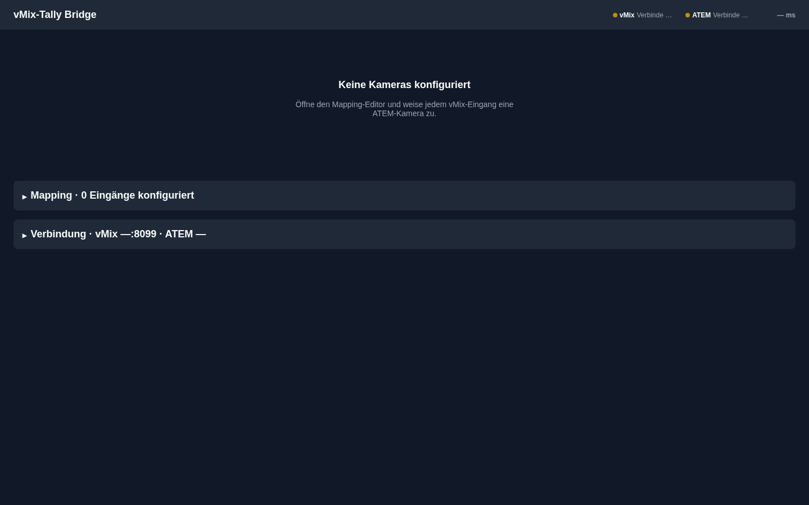

# vMix-ATEM Tally Bridge

  

Brücke, die den Live-/Preview-Tally-Zustand von vMix ausliest und den Program-/Preview-Bus eines ATEM-Switchers ansteuert, damit SDI-Kameras ihr Tally-Signal erhalten. Inklusive Web-Oberfläche zur Überwachung und Konfiguration.

## Screenshot



## Features

- Echtzeit-Tally von vMix (TCP-Befehl `SUBSCRIBE TALLY`) mit automatischem Reconnect (exponentielles Backoff)
- Ausgabe auf den ATEM Program-/Preview-Bus via `atem-connection`; erneutes Setzen des Soll-Zustands nach jedem ATEM-Reconnect
- Mapping vMix-Eingang → ATEM-Quelle → Kamera, persistent in `config.json` (lowdb)
- Web-UI (Svelte 5) mit Live-Tally-Kacheln, Verbindungsstatus, Disconnect-Banner und Mapping-Editor
- Manuelle Overrides (Program/Preview) und Testfunktion pro Kamera
- Walk-Test (`GET /walk-test`), der alle gemappten ATEM-Eingänge nacheinander durchschaltet
- WebSocket-Push (`/ws`) mit vollständigem Snapshot; CSRF-Schutz für schreibende Requests
- Dev-Simulatoren für vMix und ATEM, Installationsskripte für Debian/Proxmox-LXC (systemd)

## Tech-Stack

| Bereich | Technologie |
|---|---|
| Laufzeit | Node.js ≥ 22, TypeScript (tsx) |
| Server | Fastify 5, @fastify/websocket, @fastify/static |
| ATEM | atem-connection |
| Persistenz | lowdb, Validierung mit zod |
| Logging | pino |
| Frontend | Svelte 5, Vite |
| Tests | Vitest |

## Schnellstart

### Voraussetzungen

- Node.js ≥ 22 und npm
- Erreichbarer vMix (TCP-API, Standard-Port 8099, HTTP-API 8088) und ATEM (UDP 9910)

### Installation

```bash
git clone https://github.com/Infactionfreddy/VMIX-Tally.git
cd VMIX-Tally
npm ci
npm run build
```

### Start

```bash
npm start
```

Die Oberfläche ist danach unter `http://localhost:3000` erreichbar. vMix- und ATEM-Adresse werden im Web-UI eingetragen.

Entwicklungsmodus mit Simulatoren: `npm run dev` (siehe [Entwicklung](docs/ENTWICKLUNG.md)).

## Konfiguration

| Variable | Standard | Beschreibung |
|---|---|---|
| `PORT` | `3000` | HTTP-/WebSocket-Port des Servers |
| `NODE_ENV` | – | wird vom systemd-Service auf `production` gesetzt |

vMix-/ATEM-Adressen, Mapping und Overrides liegen in `config.json` und werden über das Web-UI gepflegt. Details: [docs/KONFIGURATION.md](docs/KONFIGURATION.md).

## Projektstruktur

```
src/
  server.ts          Einstiegspunkt, Fastify-App, Verdrahtung
  core/             Resolver, Tally-Zustand, Events
  vmix/             VmixConnector, Parser, Orchestrator, Runtime-Mapping
  atem/             AtemConnector
  config/           Schema (zod) und ConfigStore (lowdb)
  routes/           REST-Routen (overrides, config, test, vmix)
  frontend/         Svelte-Web-UI
scripts/            dev.mjs, Simulatoren, LXC-Installer
pyAtemSim-main/     Python-ATEM-Simulator (Fremdprojekt, mit eigener LICENSE)
.planning/          Planungs- und Phasendokumente
```

## Dokumentation

- [Architektur](docs/ARCHITEKTUR.md)
- [Installation](docs/INSTALLATION.md)
- [Konfiguration](docs/KONFIGURATION.md)
- [Entwicklung](docs/ENTWICKLUNG.md)
- [API](docs/API.md)

## Hinweise

Das Unterverzeichnis `pyAtemSim-main/` enthält den Fremdsimulator pyAtemSim (siehe dessen README und LICENSE).