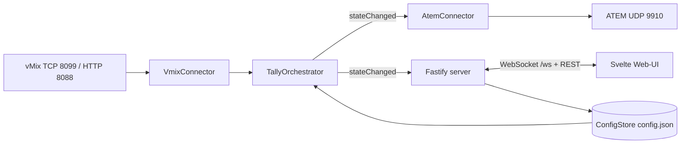
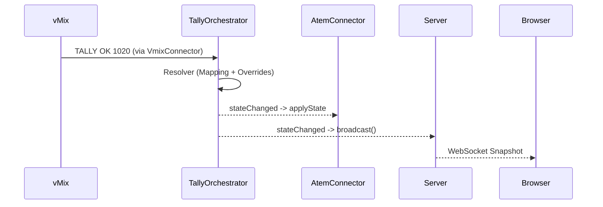

# Architektur

[← Zurück zur README](../README.md)

## Überblick

Die Bridge ist ein einzelner Node.js-Prozess. Er verbindet sich als Client mit vMix (TCP) und ATEM (UDP, `atem-connection`) und stellt zusätzlich ein Web-UI samt REST-/WebSocket-Schnittstelle bereit.

## Komponenten

| Komponente | Datei | Aufgabe |
|---|---|---|
| Server | `src/server.ts` | Einstiegspunkt; einzige Stelle, die `vmix/` und `atem/` verbindet; Fastify-App (`buildApp`), WebSocket-Broadcast, CSRF-Hook, Walk-Test |
| VmixConnector | `src/vmix/VmixConnector.ts` | TCP-Verbindung zu vMix mit Backoff, Roster (Key → Eingangsnummer) |
| parseTallyString / parseRosterXml | `src/vmix/` | Reine Parser für Tally-Ziffernstring (0/1/2) und Roster-XML |
| buildRuntimeMapping | `src/vmix/` | Baut aus dem persistierten Mapping das Laufzeit-Mapping |
| TallyOrchestrator | `src/vmix/tallyOrchestrator.ts` | Erzeugt den VmixConnector, wendet Resolver an, emittiert `stateChanged`, `reconnectVmix` |
| Resolver / TallyState | `src/core/` | Reine Logik: Tally-Array + Mapping + Overrides → `ResolverOutput` je Kamera |
| AtemConnector | `src/atem/AtemConnector.ts` | Setzt Program/Preview am ATEM, `applyState`, `walkTest`, `reconnect` |
| ConfigStore | `src/config/` | Persistenz in `config.json`, zod-Schema |
| Routen | `src/routes/` | `overrides`, `config`, `test`, `vmix` |
| Frontend | `src/frontend/` | Svelte-SPA, gebaut nach `dist/` und von Fastify statisch ausgeliefert |

## Datenfluss

1. vMix pusht Tally-Strings; der Parser wandelt sie in ein positionelles Array (Index i = Eingang i+1).
2. Der Resolver berechnet pro Kamera `program`/`preview`/`off` unter Berücksichtigung von Overrides.
3. Bei `stateChanged` setzt der `AtemConnector` die Busse; nach einem ATEM-Reconnect wird der aktuelle Soll-Zustand erneut gesetzt.
4. Der Server sendet einen vollständigen Snapshot an alle offenen WebSocket-Clients (auch beim Verbindungsaufbau).

## Verbindungsstatus

Status je System: `connecting`, `connected`, `disconnected`. Ein `disconnected` wird um 400 ms verzögert, damit kurze Reconnect-Zyklen die UI nicht flackern lassen.

## Registrierungsreihenfolge in Fastify

`@fastify/static` → `@fastify/websocket` → CSRF-Hook → REST-Routen → `/walk-test` → `/ws`.

## Bekannte Eigenheiten

- `latencyMs` im Snapshot ist aktuell immer `null` (Event liefert keinen Empfangszeitstempel); die Latenz steht in den pino-Logs (Annahme laut Code-Kommentar).
- Der Server greift per Cast auf das interne Feld `connector` des Orchestrators zu.